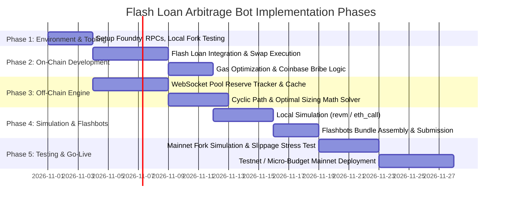

# Advanced Ethereum Flash Loan Arbitrage Bot: Engineering Plan & Blueprint

Building a production-grade EVM Flash Loan Arbitrage bot requires coordinating high-speed off-chain state calculation, mathematical trade sizing, atomic on-chain execution, and private mempool bundle submission (Flashbots/MEV-Share) to prevent frontrunning.

---

## 1. High-Level Architecture Overview

```mermaid
flowchart TD
    subgraph Mempool & Chain Data
        RPC[Ethereum Node / Websocket] -->|Blocks & State Diffs| Engine[Off-Chain Detection Engine]
        PrivatePools[Pending Tx / MEV-Share] -->|Mempool Events| Engine
    end

    subgraph Off-Chain Arbitrage Engine
        Engine --> StateCache[Local In-Memory Reserves Cache]
        StateCache --> PathFinder[Triangular / Cross-DEX Path Engine]
        PathFinder --> MathSizer[Optimal Input Sizing Model]
        MathSizer --> FastSim[Local EVM Simulator (revm / eth_call)]
        FastSim -->|Profitable Arbitrage| BundleBuilder[Flashbots Bundle Builder]
    end

    subgraph MEV Submission & Execution
        BundleBuilder -->|eth_sendBundle| Relays[MEV Relays: Flashbots, Titan, Beaver]
        Relays --> Builders[Block Builders]
        Builders -->|Inclusion in Next Block| Miner[Validator / block.coinbase]
        Builders --> Contract[On-Chain Flash Loan Arbitrage Contract]
    end

    subgraph On-Chain Atomic Arbitrage
        Contract -->|1. Borrow Flash Loan| Lender[Balancer v2 / Aave v3 / Uniswap v3]
        Contract -->|2. Swap Low Price| DEX_A[DEX A (e.g., Uniswap v3)]
        Contract -->|3. Swap High Price| DEX_B[DEX B (e.g., SushiSwap / Curve)]
        Contract -->|4. Repay Loan + Fee| Lender
        Contract -->|5. Bribe Miner| Miner
        Contract -->|6. Retain Net Profit| Owner[Bot Treasury]
    end
```

---

## 2. Core Components Breakdown

### 2.1. The On-Chain Executor (`ArbitrageExecutor.sol`)
An optimized smart contract deployed on Ethereum mainnet or L2s:
- **Flash Loan Providers**: 
  - **Balancer v2 Vault** (0% fee flash loans, preferred for Ethereum L1).
  - **Aave v3 Pool** (0.05% fee).
  - **Uniswap v2 / v3 Flash Swaps** (fee depends on pool tier).
- **Execution Logic**:
  1. Receive flash loan callback (`receiveFlashLoan` or `executeOperation`).
  2. Perform multi-hop atomic swaps (e.g., WETH -> Token on DEX A, Token -> WETH on DEX B).
  3. Strict slippage assertions: Ensure final balance >= Loan Amount + Loan Fee + Target Profit + Coinbase Bribe.
  4. Repay the flash loan.
  5. Pay the builder bribe dynamically using `block.coinbase.transfer(bribeAmount)`.
- **Gas Optimization**: Custom assembly/Yul or minimal proxy routing, bypassing standard router overhead to minimize execution gas (aiming for < 150k - 200k gas).

### 2.2. Off-Chain Detection Engine
- **Language Stack**: **Rust** (fastest, utilizing `ethers-rs` / `alloy` and `revm`) or **TypeScript / Node.js** (utilizing `viem`, `ethers.js`, and worker threads).
- **State Synchronization**:
  - Maintain an in-memory replica of DEX pool reserves using WebSocket subscriptions to `Sync` (Uniswap v2) and `Swap` / `Mint` / `Burn` (Uniswap v3).
  - Query multicall state diffs on every new block header to prevent drift.
- **Fast Simulation**: Use an in-process EVM (like `revm` in Rust) or parallel `eth_callBundle` to simulate the exact tx execution without network round trips.

### 2.3. Optimal Trade Sizing & Mathematical Models
Arbitrage profitability is not monotonic with trade size because AMMs exhibit price slippage. 

For two Uniswap v2 constant-product pools with reserves $(x_1, y_1)$ and $(x_2, y_2)$ and fee multiplier $\gamma = (1 - \text{fee})$:
- The optimal trade input $\Delta x^*$ is obtained analytically by setting the derivative of the net profit function $\frac{d(\text{Profit})}{d(\Delta x)} = 0$.
- For concentrated liquidity (Uniswap v3) and multi-token invariant curves (Curve Finance), closed-form solutions are complex; a fast **Newton-Raphson numerical solver** or **bounded ternary search** calculates optimal input within 1–2 milliseconds.

### 2.4. MEV Protection & Bundle Submission
Never broadcast arbitrage transactions to the public mempool:
- Public mempool trades will be intercepted, front-run, or copied by generalized searchers with higher gas.
- Use **Flashbots Builder RPC** (`eth_sendBundle`) to submit private transaction bundles directly to block builders (Flashbots, BeaverBuild, Titan, Builder0x69).
- Bribe strategy: Set a base priority fee to cover intrinsic inclusion, and allocate $85\% - 95\%$ of gross MEV profit to `block.coinbase` via contract bribe. Bundles that fail to make profit revert safely off-chain with **zero gas cost**.

---

## 3. Step-by-Step Implementation Roadmap



### Phase 1: Tooling & Development Environment Setup
1. **Smart Contract Framework**: Setup Foundry (`forge`, `anvil`, `cast`) for ultra-fast local testing and mainnet forking.
2. **RPC Infrastructure**: 
   - Primary: High-speed WebSocket node (e.g., Alchemy, QuickNode, or Infura).
   - Secondary / Pro: Dedicated execution client (Reth / Geth) with low latency.
3. **Directory Structure**:
   ```text
   EVM/
   ├── contracts/            # Foundry Solidity project
   │   ├── src/
   │   │   ├── ArbitrageExecutor.sol
   │   │   ├── interfaces/
   │   │   └── libraries/
   │   ├── test/
   │   └── foundry.toml
   ├── bot/                  # Off-chain engine (TypeScript or Rust)
   │   ├── src/
   │   │   ├── listeners/    # Pool sync & block listener
   │   │   ├── math/         # Closed-form & numerical sizing
   │   │   ├── simulation/   # Local EVM fork simulation
   │   │   └── relays/       # Flashbots bundle dispatch
   │   └── package.json / Cargo.toml
   └── config/
       └── tokens.json       # Whitelisted token pairs & pool addresses
   ```

### Phase 2: On-Chain Smart Contract Engineering
1. **Flash Loan Ingestion**: Implement Balancer v2 `IFlashLoanRecipient` (zero fee) as primary, with Aave v3 `IFlashLoanSimpleReceiver` as fallback.
2. **Low-Level Swap Execution**:
   - Uniswap v2: Direct low-level calls to `pair.swap(amount0Out, amount1Out, to, "")`.
   - Uniswap v3: Call `pool.swap(recipient, zeroForOne, amountSpecified, sqrtPriceLimitX96, data)` or router single-hop.
3. **MEV Builder Bribe Mechanism**:
   ```solidity
   uint256 netProfit = finalBalance - flashLoanDebt;
   require(netProfit >= minProfit, "Insufficient profit");

   uint256 minerBribe = (netProfit * bribePercentage) / 100;
   block.coinbase.transfer(minerBribe);
   ```
4. **Security Hardening**:
   - Access control (`onlyOwner`) on execution entrypoints.
   - Emergency token rescue function.
   - Strict sanity checks on recipient addresses to prevent arbitrary code execution attacks.

### Phase 3: Off-Chain Detection & Reserve Tracking
1. **Pool Discovery & Filtering**:
   - Query factory contracts (`UniswapV2Factory`, `UniswapV3Factory`) for target high-volume pairs (e.g., WETH/USDC, WETH/USDT, WBTC/WETH).
   - Filter out low-liquidity pools to avoid toxic debt or illiquid pools with fake volume.
2. **Real-Time State Maintenance**:
   - Listen to `Sync(uint112,uint112)` events to update pool reserves in under 5ms.
   - Maintain a directed acyclic graph (DAG) or adjacency list of swap pairs for cyclic path traversal (e.g., WETH -> TokenA -> TokenB -> WETH).

### Phase 4: Local Simulation & Sizing Optimization
1. **Mathematical Trade Sizer**:
   - Compute optimal input amount $x^*$ that maximizes $f(x) = \text{Output}(x) - x - \text{GasFees} - \text{LoanFees}$.
2. **Simulation Layer**:
   - Test the generated transaction payload using `anvil` or `eth_callBundle` before bundle creation.
   - Discard opportunities where simulated gross profit does not surpass gas + priority fee thresholds.

### Phase 5: Bundle Assembly & MEV Submission
1. **Targeting Blocks**:
   - Fetch the latest block number $N$.
   - Target inclusion in block $N + 1$.
2. **Bundle Construction**:
   - Package: `[arbitrage_tx]` (or `[target_pending_tx, arbitrage_tx]` for backrunning).
   - Set `maxBlockNumber: currentBlock + 1` so stale transactions never execute in subsequent blocks if missed.
3. **Multi-Relay Dispatch**:
   - Concurrently send the bundle to major block builders:
     - Flashbots (`https://relay.flashbots.net`)
     - BeaverBuild (`https://rpc.beaverbuild.org/`)
     - Titan (`https://rpc.titanbuilder.xyz`)

---

## 4. Key Profitability & Risk Mitigations

| Risk Vector | Impact | Mitigation Strategy |
| :--- | :--- | :--- |
| **Frontrunning / Sandwiching** | Total loss of arb profit | **Mandatory:** Zero public mempool transactions. Route 100% via Flashbots private bundles. |
| **Failed Reverts & Gas Waste** | Burned gas fees on failed trades | Bundle simulation ensures failing transactions are never mined. The block builder drops non-profitable bundles. |
| **State Race Conditions** | Other MEV bots taking the same arb | Microsecond-level off-chain math + multi-builder relay broadcasting. |
| **Honeypot Tokens** | Capital locked in untradable token | Restrict trading strictly to verified token whitelists (WETH, USDC, USDT, DAI, WBTC, LINK, UNI, etc.). |
| **Flash Loan Fee Drag** | Margin erosion | Prioritize Balancer v2 (0% fee) over Aave (0.05%) whenever Balancer holds sufficient liquidity. |

---

## 5. Technology Stack Recommendation

- **Smart Contracts**: Solidity `^0.8.24` + Foundry
- **Off-Chain Engine**:
  - *Option A (Recommended for performance)*: **Rust** with `alloy-rs` + `revm` for microsecond latency.
  - *Option B (Recommended for rapid development)*: **TypeScript** with `viem` + `ethers.js` + Flashbots SDK.
- **Node Access**: High-tier WebSocket endpoint (Alchemy / QuickNode / local Geth/Reth node).
